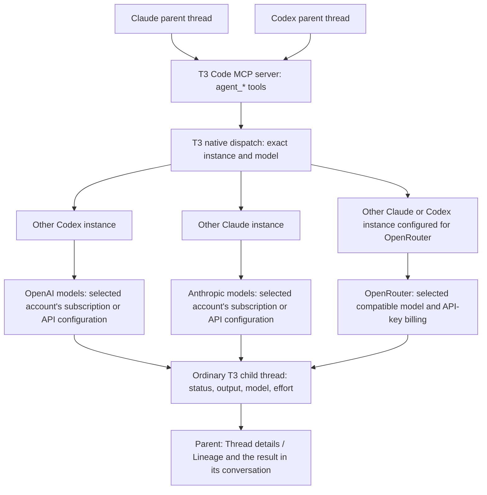

# Cross-provider agents

A Claude or Codex thread can hand work to a child thread on one of your _other_ configured
providers: a Claude orchestrator can delegate to your Codex subscription, and a Codex thread can
delegate to Claude. Each child is an ordinary thread in the same project, worktree, and branch, and
appears under **Thread details → Lineage** on the parent while it runs, with its status, elapsed
time, model and effort. Hovering its row also shows the tokens and tool calls the child has used
so far (`— tok` until its provider reports usage). Delegating inside one provider keeps using T3
Code's native `delegate_task` tool, which stays available alongside; this feature only covers
crossing providers.

Hover a thread in the sidebar to check its current context usage and limit, lifetime tokens across handoffs, and tool calls, excluding child threads.

Children do not appear in the thread list, search, the command palette, or the mobile home screen.
Open one by clicking its row under **Lineage** on the parent; it is a normal thread from there, and
its own **Lineage** lists the children it started, so you can drill down one level at a time. A
child's link keeps working after a reconnect.

A child runs at the reasoning effort the parent asked for. When the parent does not ask, the child
uses the parent thread's own effort if the other provider's model offers that level, otherwise that
model's default.

## Turning it on

Open **Settings → Integrations → Agents**, select the environment you want to configure, and enable
**Cross-provider agent access**. Claude and Codex sessions that start or resume after that get the
tools; running sessions pick them up on their next start.

Both harnesses reach the tools through T3 Code's built-in MCP server, so they appear to the agent
as `mcp__t3-code__agent_catalog`, `mcp__t3-code__agent_spawn`, `mcp__t3-code__agent_wait`,
`mcp__t3-code__agent_result`, `mcp__t3-code__agent_follow_up` and `mcp__t3-code__agent_interrupt`.
If you mention a tool in a prompt, the bare name (`agent_spawn`) is enough.

Children use the provider instance you configured, with that instance's own sign-in and billing, so
a delegated task may consume the other provider's paid quota.

## Choosing who can be a target

By default every Claude and Codex instance that is enabled, installed and currently available is a
target with all of its models, including API-key-backed instances whose sign-in status is unknown.
An instance is left out while it is signed out, not installed, unavailable or unable to run child
tasks, and for threads in a project that has the instance turned off.
Select one connected environment and expand **Routes** to switch its instances off or limit the
models an agent may pick. **Restore defaults** discards your edits and goes back to tracking your
provider list.

**Max orchestration depth** (1 to 5) decides how far delegation can nest: `1` lets the parent spawn
children that cannot delegate further; `2` (the default) lets a child that was explicitly granted
the tools fan out one more level, and so on up to 5. The limit covers native `delegate_task` too: a
child that was not granted orchestration has neither the `agent_*` tools nor `delegate_task`.

**Child output cap** limits how much of a child's final answer is returned to the parent in one
piece. Longer answers come back as a head and a tail, clearly marked, and the parent can request
the rest.

## Getting results back

The parent does not need to wait. When a child finishes, fails or is interrupted, the parent is
woken with a visible message in its conversation that carries the child's result inline (capped as
above), and continues from there. A follow-up sent to a finished child reports back the same way.

`agent_wait` only retrieves results that are already there: it returns within 5 seconds, and a
thread that calls it more than 10 times in a minute is told to stop. To wait for a period of time,
the agent should use the [scheduled wake-up](./heartbeat.md) tools instead.

## Cross-lab and cross-subscription dispatch

The destination is a specific provider instance and an exact model from its catalog. For example,
a Claude parent can delegate to a Codex instance signed into an OpenAI subscription, and a Codex
parent can delegate to a Claude instance signed into an Anthropic subscription. Separate accounts
use separate configured instances. The destination's credentials and billing apply to its work.

The diagram shows alternative destinations. Each spawn selects one exact instance and model;
T3 does not substitute another provider or silently fall back to OpenRouter. The current caller
instance is excluded as a cross-provider target. Work inside that same instance continues to use
native `delegate_task`.

Claude and Codex are the supported dispatch harnesses. Other labs' models can participate through
an OpenRouter configuration supported by one of those harnesses, provided the instance exposes
the model in its catalog and the route allows it. Other T3 provider drivers do not gain these
cross-provider tools.

## OpenRouter

Use the existing provider-instance configuration in **Settings → Providers**. The
[Claude OpenRouter setup](./providers-claude.md#openrouter) describes the direct endpoint and
credential settings. A Codex instance already configured for a compatible OpenRouter model can
also participate through its existing Codex configuration. Keep router-backed instances separate
from subscription instances so the intended account, endpoint, and billing are explicit.

Enable the instance and confirm its model appears in the provider catalog, then allow that
instance and model under **Settings → Integrations → Agents → Routes**. API-key instances remain
eligible when their authentication status is unknown; an explicitly signed-out instance is
excluded. Ask the parent to use that exact instance and model and check the child row and
OpenRouter activity to confirm the destination.

No CLI proxy or separate routing daemon is required. T3 dispatches through the configured
provider's existing harness; compatibility with the selected model and endpoint still depends on
that harness.

## Remote environments

This fork retains T3 Code's existing [remote access](./remote-access.md) and machine load
balancing. Machine selection places a new parent thread on an environment; cross-provider
dispatch then selects another provider instance on that environment. Child threads share the
parent's project, worktree, and branch. Cross-provider dispatch does not itself move a child to
another machine.

## Things to know

- Both Claude and Codex keep the tools when T3 resumes a session, for example after the server
  restarts.
- Interrupting a child, following it up, or reading its result works from the parent thread as well
  as from the child's own view. **Stop** on a child's **Lineage** row interrupts its current turn.
- The depth limit counts children started with `agent_spawn` and `delegate_task`. Tools that create
  new top-level threads start a fresh lineage and are not counted.
- If a provider retries a spawn after losing T3's reply, a second child can occasionally appear.
  Stop the extra one from **Lineage**.
